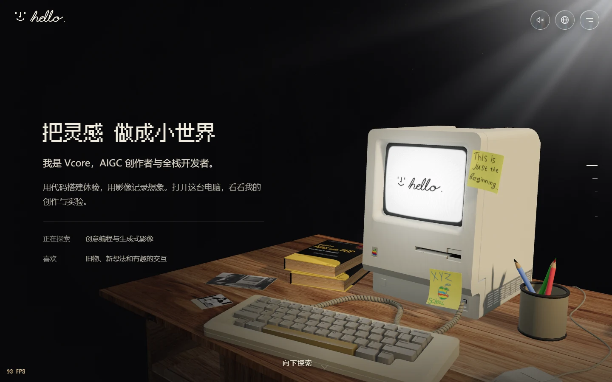
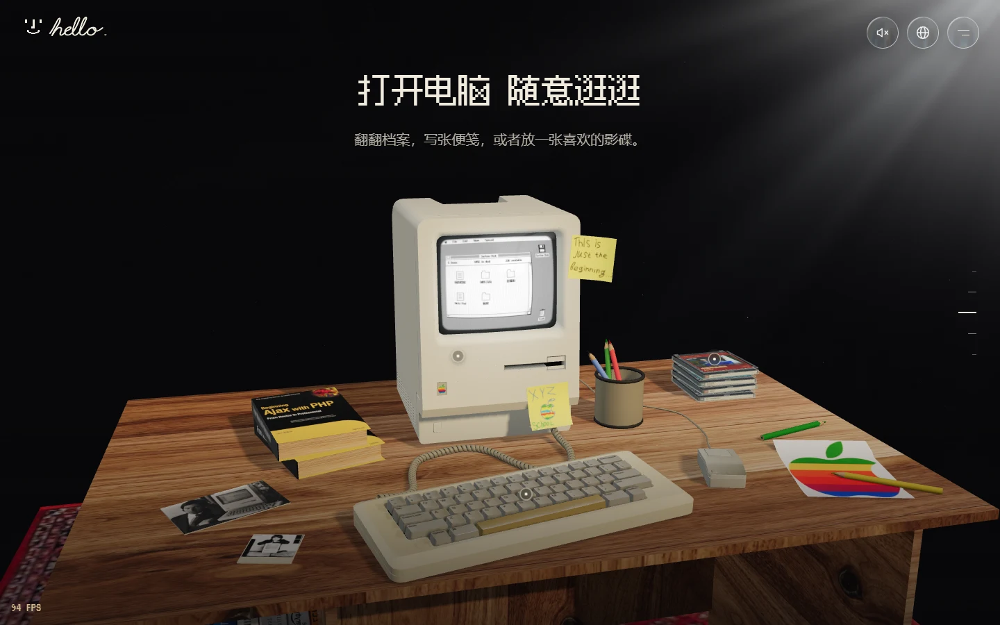
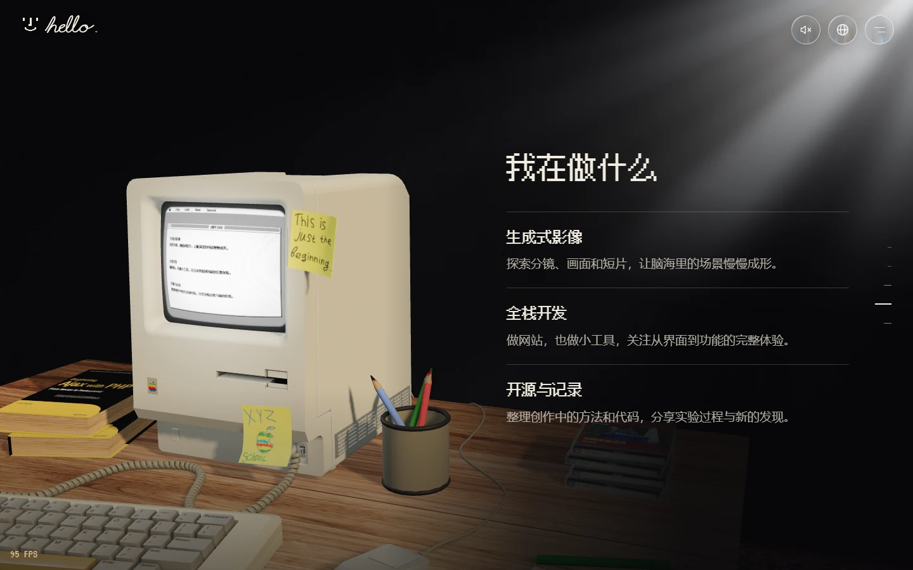
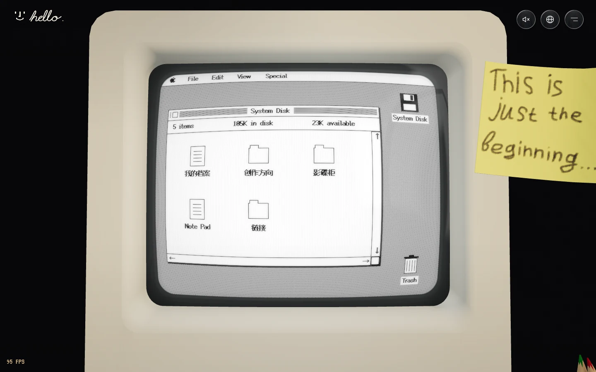
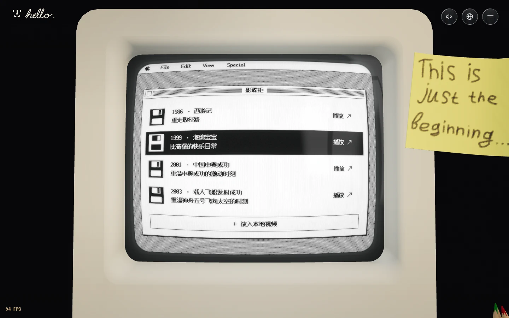
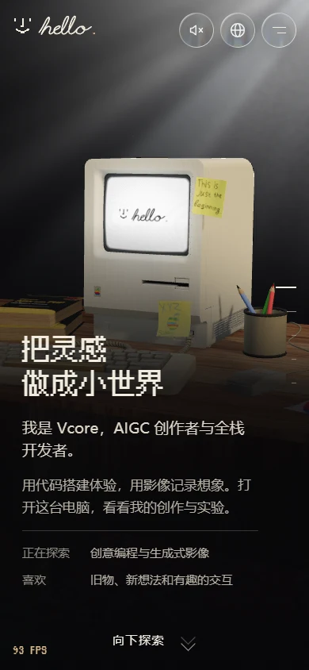
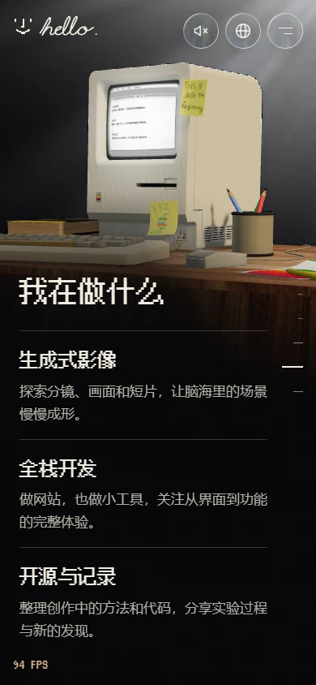

# hello. — Macintosh 3D Retro Personal Website

[简体中文](README.md) | **English**

A **Macintosh 3D retro personal website**, built with Three.js. Explore a Macintosh 128K desk, click the computer to open its pixel desktop, browse a profile, write a note, or insert a disc to play a video.

Use it as a personal homepage, a creative portfolio, or a hands-on example of Three.js and web interaction. The model, fonts, and sample content are included. Run it locally, replace the profile and videos, and make it your own. **Frontend only: no backend, database, or API key required.**



[Quick start](#quick-start) · [Feature preview](#feature-preview) · [Make it yours](#make-it-yours) · [Copy this prompt for an AI agent](#copy-this-prompt-for-an-ai-agent) · [Tech stack](#tech-stack) · [Build and publish](#build-and-publish) · [Licenses and credits](#licenses-and-credits)

## Quick start

Install **Node.js 22.12+** (npm is included) and use a modern browser with WebGL 2 support.

```bash
git clone https://github.com/wwnetboy/macintosh-web.git
cd macintosh-web
npm ci
npm run dev
```

Open the local URL printed in your terminal, normally [http://127.0.0.1:5173/](http://127.0.0.1:5173/). If that port is busy, use the address Vite prints instead.

You can also choose **Code → Download ZIP** on GitHub, extract the project, open a terminal in its folder, and start with `npm ci`.

Prefer to use an AI coding tool? Copy the [AI agent prompt](#copy-this-prompt-for-an-ai-agent) below to have it run and customize the project.

## Feature preview

### A 3D desk you can explore

Five full-screen chapters introduce the person, the old computer, the interactive desk, creative practice, and a closing message. Scrolling moves the camera between chapters. Drag to rotate the view, or jump to a chapter using the right-hand markers or navigation menu.

| Interactive desk | Creative practice |
| --- | --- |
|  |  |

### A little desktop inside the old computer

Click the case to inspect the computer, then click its screen to explore the retro desktop. Open the profile, creative practice, movie library, links, or notepad. The CRT effect recreates a vintage tube display with curved glass, scanlines, and a soft glow.

| Retro desktop | Movie library |
| --- | --- |
|  |  |

- **Disc playback**: select a physical disc or a library entry to open the case, lift the disc, insert it, and play a video. Pause, change discs, eject, or choose a local video file.
- **Power and sound**: startup shows Happy Mac and a handwritten `hello.`; shutdown collapses the picture into a point of light. Sound starts muted and can be enabled in the top-right corner.
- **Chinese and English UI**: the site defaults to Chinese. Switch to English using the top-right language menu; the browser remembers your choice.
- **Touch and keyboard controls**: swipe vertically to change chapters and drag horizontally to rotate on mobile. Desktop controls include arrow keys, Page Up / Down, Home / End, and Esc.
- **Reduced motion**: animations adapt to the system preference. Page text remains readable when the 3D scene fails to load.

### Mobile layouts

Text placement and camera distance adapt to smaller screens, with desk exploration and screen controls available on mobile.

| Mobile homepage | Mobile creative practice |
| :---: | :---: |
|  |  |

These are browser screenshots of the current project, showing its default Chinese interface. Mobile screenshots use an emulated 390 × 844 viewport; actual performance depends on the device and browser.

## Make it yours

Most content changes start in [src/content/site.js](src/content/site.js). You do not need to understand the rendering code first.

| What to change | Where to edit |
| --- | --- |
| Page title, description, and author | `meta` |
| Name, role, biography, and personal website | `identity` |
| Social and contact links | `identity.links`; each entry takes `label`, `href`, and an optional `icon` |
| Project GitHub link | `repositoryUrl` |
| Homepage heading, introduction, and details | `hero`; `{name}` in `hero.line` uses your configured name |
| Chapter text and creative practice | `sections`; practice items are under `id: 'work'` → `blocks` → `type: 'practice'` → `items` |
| Video titles, years, covers, and file paths | `disks` |

For example, change `identity.name`, `hero.title`, and `hero.description` to update the homepage. The profile inside the computer reads `identity`, and the creative-practice view shares the same content as the page.

**Before publishing, also check these two files:**

- Update the static `<title>`, description, author, and Open Graph metadata in [`index.html`](index.html) for search engines and link previews.
- English translations live in [`src/content/i18n.js`](src/content/i18n.js), using a dictionary of Chinese source text and English translations. When you change Chinese copy, update its translation too. Missing translations fall back to the original text.

### Replace videos and covers

Place videos you have permission to distribute in `public/media/`, put covers in `public/media/covers/`, and replace an entry in `disks`. For example:

```js
{
  id: 'my-film',
  title: 'My first short film',
  year: '2026',
  color: '#625574',
  kind: 'video',
  src: 'media/my-film.mp4',
  cover: 'media/covers/my-film.webp',
  note: 'From an idea to a moving image'
}
```

Paths are relative to the contents of `public/`: **do not include the `public/` prefix**. Give every disc a unique `id`. The cover is used on both the case and the disc.

Start by replacing existing entries, using a browser-supported format such as MP4/H.264. Remote videos must allow cross-origin access so their frames can be drawn onto the CRT canvas. Choosing a local video only plays it in the current browser; it does not upload the file or change project configuration.

## Copy this prompt for an AI agent

On GitHub, use the copy button in the top-right corner of the code block below. Paste it into an AI coding tool that can read files and run terminal commands. Fill in your details to personalize the site, or leave them blank to run the existing example first.

```text
Please reproduce and run this 3D retro personal website using its existing source:
https://github.com/wwnetboy/macintosh-web

Goal: preserve the current scene, layout, and interactions, get the project running, then customize it with the details below.

My details (keep sample content for any blank fields):
- Name:
- Role / profession:
- Short biography:
- Creative practice / project descriptions:
- Personal website / social links:
- Video and cover files:

Please follow these steps:
1. Use the project in the current directory if it is already present; otherwise clone it into a new folder. Preserve existing changes and unrelated files.
2. Read README.en.md, package.json, src/content/site.js, src/content/i18n.js, and THIRD_PARTY.md to understand the structure and asset licenses.
3. Check for Node.js 22.12+, run npm ci and npm run dev, and report the actual local URL. No backend, database, or API key is required.
4. Customize the existing implementation. Preserve the Macintosh model, warm window light, five chapters, scroll-driven camera, CRT pixel desktop, boxed discs, and disc-insertion playback.
5. Edit profile and video content mainly in src/content/site.js. Update the static metadata in index.html and affected English translations in src/content/i18n.js.
6. Place videos in public/media/ and covers in public/media/covers/. Do not include public/ in configured paths. If I have not supplied media, keep the existing configuration and explain how to replace it later.
7. Keep the native JavaScript + Three.js + GSAP + Vite stack. Add dependencies only when needed for the requested work. Preserve LICENSE, third-party credits, and license notices.
8. Run npm run build. If browser tools are available, check desktop and mobile layouts, paging, screen clicks, disc playback, and language switching, and provide screenshots. Clearly list anything you could not test.
9. Report changed files, explain how to keep editing content, and describe how to preview and publish dist/. Confirm the target hosting platform before publishing publicly.

Complete the work you can perform locally instead of only proposing a plan. Keep sample content when personal details are missing; do not invent them.
```

## Tech stack

| Technology | What it does here |
| --- | --- |
| **Native JavaScript / HTML / CSS** | Page structure, content configuration, responsive layouts, and controls |
| **Three.js** | GLB loading and rendering for the computer, desk, discs, cameras, and lights |
| **GLSL shaders** | CRT display, glass reflections, window light, and atmosphere |
| **Canvas 2D** | Pixel rendering for desktop windows, text, and video frames inside the computer |
| **GSAP + SplitText** | Character-by-character text entrance animations |
| **Web Audio API** | Synthesized power, key, and disc sounds |
| **Vite** | Local development, hot reload, and static builds |

Runtime dependencies are **Three.js and GSAP**, with Vite for development and builds. Full notices for adapted components remain with the source and in the notice files under `public/`.

To explore the implementation, start with these directories:

```text
src/
├── content/       # Profile, chapters, videos, and Chinese/English translations
├── core/          # 3D stage, camera, audio, and asset paths
├── scene/         # Computer, CRT, disc cases, lighting, and shaders
├── ui/            # Page controls, paging, text animation, and glass buttons
├── styles/        # Page styles and mobile layouts
└── main.js        # Connects the scene, content, and interactions
public/
├── models/        # Macintosh GLB model
├── media/         # Videos and covers
└── fonts/         # Local pixel fonts and their licenses
```

Edit `camera.presets` in `site.js` to change camera compositions. Replacing the 3D model also requires matching the mesh names in `parts`, drive position, and display area in `screen`. Keep the included model for your first customization.

## Build and publish

```bash
npm run build
npm run preview
```

`npm run build` generates the `dist/` directory. Run `npm run preview` and open the preview URL printed in your terminal, normally [http://127.0.0.1:4173/](http://127.0.0.1:4173/).

If that port is busy, use the address printed in your terminal. Open the site through an HTTP server rather than double-clicking `dist/index.html`.

Use a static hosting service with build command `npm run build` and output directory `dist`. For a manual upload, upload all contents of `dist/` and preserve their directory structure.

The project uses relative asset paths to support both root-domain hosting and subdirectories such as GitHub Pages. Common issues:

| Issue | What to check |
| --- | --- |
| Installation or startup fails | `node -v` is 22.12+ and the terminal is in the folder containing `package.json` |
| Model does not appear | WebGL 2 support, browser hardware acceleration, and a complete uploaded `models/` folder |
| Video is black or fails to load | File path, browser-supported encoding, and cross-origin settings for remote files |
| New Chinese text remains Chinese in English mode | Add the matching source text and translation in `src/content/i18n.js` |
| Mobile performance is slow | Reduce video and cover sizes first, then check on the target device |

## Licenses and credits

Application code written for this project uses the [MIT license](LICENSE). **Models, videos, fonts, and some adapted components have separate licenses; the repository's assets are not all MIT-licensed.**

- The Macintosh 128K model is by **kreems**, licensed under **CC BY 4.0**. Retain attribution, the original link, and modification notes when using or distributing it.
- Pixel fonts use **SIL OFL 1.1**. GSAP uses its **Standard License**.
- The Liquid Glass adaptation uses **MIT**. The React Bits SideRays / SplitText adaptations use **MIT + Commons Clause**.
- Sample videos and covers derived from their frames are excluded from the project's MIT license. Some were supplied without redistribution permission. Replace them with your own or appropriately licensed media before publishing your version.

See [THIRD_PARTY.md](THIRD_PARTY.md) for model, video, font, and dependency notes. Full notices for adapted components are included in the accompanying notice files.
