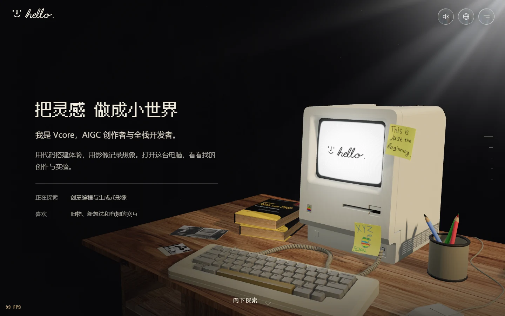
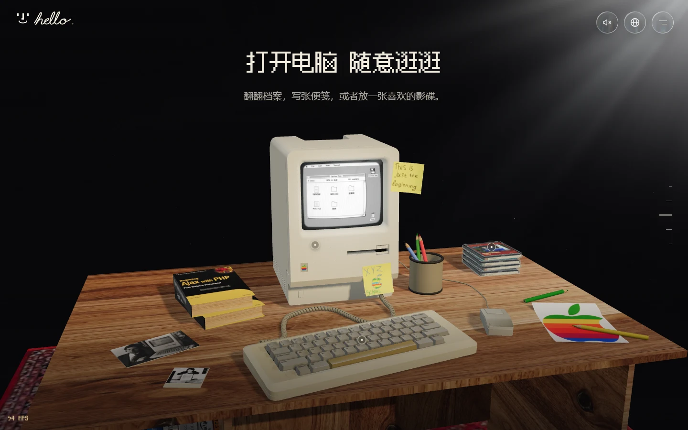
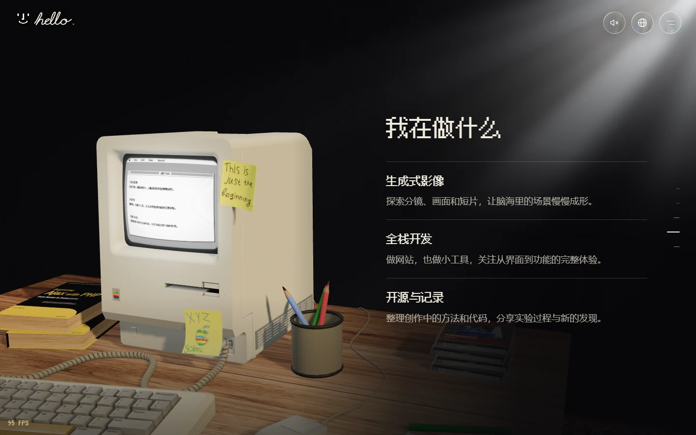
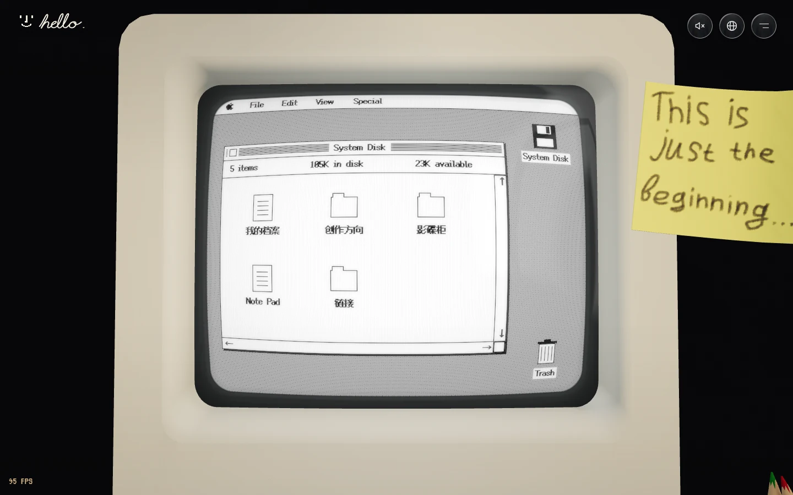
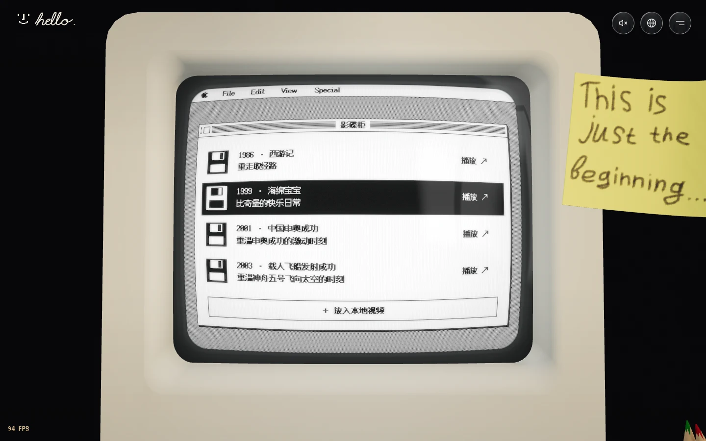
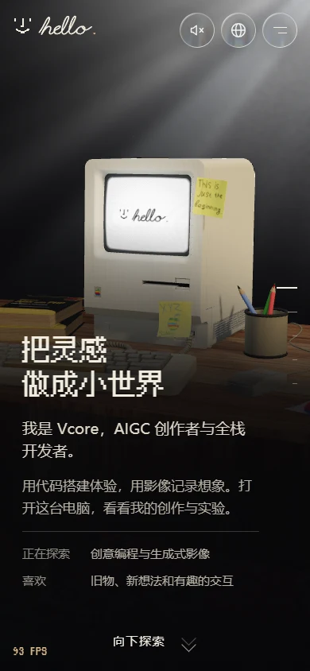
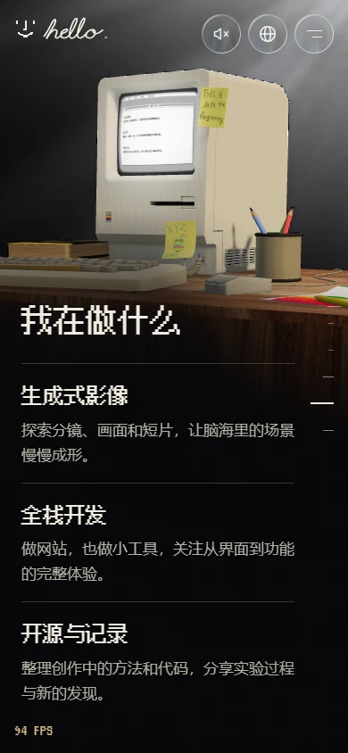

# hello. — Macintosh 麦金塔 3D 复古个人网站

**简体中文** | [English](README.en.md)

基于 Three.js 打造的 **Macintosh 麦金塔 3D 复古个人网站**。滚动探索 Macintosh 128K 书桌，点击电脑打开像素桌面，浏览个人档案、写便笺，或插入光盘播放视频。

适合作为个人主页、创作者作品展示，也适合用来学习 Three.js 场景与网页交互。项目自带模型、字体和示例内容，下载后即可运行；替换资料和视频，就能做成自己的版本。**纯前端，无需后端、数据库或 API Key。**



[快速开始](#快速开始) · [功能预览](#功能预览) · [换成你的内容](#换成你的内容) · [复制给 AI agent](#复制给-ai-agent) · [技术栈](#技术栈) · [构建与发布](#构建与发布) · [许可与致谢](#许可与致谢)

## 快速开始

准备好 **Node.js 22.12+**（自带 npm），以及支持 WebGL 2 的现代浏览器。

```bash
git clone https://github.com/wwnetboy/macintosh-web.git
cd macintosh-web
npm ci
npm run dev
```

打开终端显示的本地地址，默认是 [http://127.0.0.1:5173/](http://127.0.0.1:5173/)。端口被占用时，以终端实际输出为准。

不会用 Git，也可以在仓库页面选择 **Code → Download ZIP**，解压后在项目目录打开终端，从 `npm ci` 开始执行。

想交给 AI 完成？直接复制下方的 [AI agent 提示词](#复制给-ai-agent)，让它帮你运行并修改项目。

## 功能预览

### 一张可以探索的 3D 书桌

五个全屏章节串起个人介绍、旧机器、互动书桌、创作方向和结束语。滚动时镜头随章节切换；拖动可以旋转观察，右侧刻度和导航菜单可以直接跳转。

| 互动书桌 | 创作方向 |
| --- | --- |
|  |  |

### 老电脑里，藏着一个小桌面

点击机身查看电脑，再点击屏幕进入复古桌面。里面可以打开个人档案、创作方向、影碟柜、链接和便笺。CRT 是老式显像管屏幕的效果，带有曲面玻璃、扫描线和柔和辉光。

| 复古桌面 | 影碟柜 |
| --- | --- |
|  |  |

- **光盘播放**：点击桌面光盘或影碟柜条目，体验开盒、取盘、插入和播放；支持暂停、换片、退盘，也可以选择本地视频。
- **开关机与声音**：开机出现 Happy Mac 与手写 `hello.`，关机收束为光点。声音默认关闭，可在右上角开启。
- **中英文界面**：网站默认中文，右上角可切换 English，并在浏览器中记住选择。
- **手机与键盘操作**：手机纵向滑动翻页、横向拖动旋转；电脑支持方向键、Page Up / Down、Home / End 和 Esc。
- **减少动态效果**：跟随系统偏好简化动画；3D 加载失败时，仍可阅读页面文字。

### 手机也能浏览

页面会调整文字排布和镜头距离，保留书桌探索与屏幕操作。

| 手机首页 | 手机创作方向 |
| :---: | :---: |
|  |  |

以上均为当前项目的浏览器实拍截图。手机截图使用 390 × 844 视口模拟，实际流畅度取决于设备与浏览器。

## 换成你的内容

大多数日常修改，都从 [src/content/site.js](src/content/site.js) 开始，不用先了解 3D 渲染代码。

| 想修改什么 | 在哪里改 |
| --- | --- |
| 网页标题、描述、作者 | `meta` |
| 姓名、职业、个人简介、个人网站 | `identity` |
| 社交链接与联系方式 | `identity.links`，每项填写 `label`、`href`，可选 `icon` |
| 项目的 GitHub 链接 | `repositoryUrl` |
| 首屏标题、身份介绍、说明条目 | `hero`；`hero.line` 中的 `{name}` 会读取姓名 |
| 章节文案与创作方向 | `sections`；创作方向位于 `id: 'work'` → `blocks` → `type: 'practice'` 的 `items` |
| 视频名称、年份、封面、文件路径 | `disks` |

例如，把 `identity.name` 改成你的名字，再改 `hero.title` 和 `hero.description`，首页就会变成你的介绍。电脑内的档案会读取 `identity`，创作方向也会与页面共用同一份配置。

**准备发布时，再检查两处：**

- [`index.html`](index.html) 中的 `<title>`、描述、作者和 Open Graph 信息也应同步修改，方便搜索引擎和链接预览读取。
- 网站英文翻译位于 [`src/content/i18n.js`](src/content/i18n.js)，通过“中文原文 → 英文”的字典匹配。改了中文文案，需要更新对应翻译；没有翻译的内容会显示原文。

### 替换视频和封面

把你有权分发的视频放进 `public/media/`，封面放进 `public/media/covers/`，再替换 `disks` 中的条目。例如：

```js
{
  id: 'my-film',
  title: '我的第一部短片',
  year: '2026',
  color: '#625574',
  kind: 'video',
  src: 'media/my-film.mp4',
  cover: 'media/covers/my-film.webp',
  note: '记录灵感变成画面的过程'
}
```

路径从 `public/` 内开始写，**不要加 `public/` 前缀**。每张光盘的 `id` 应保持唯一。封面会同时用于光盘盒与盘面。

建议先替换现有条目，并使用浏览器支持的 MP4/H.264 视频。远程视频需要允许跨域读取，才能显示在 CRT 的 Canvas 中。“选择本地视频”只用于当前浏览器播放，不会上传文件，也不会修改项目配置。

## 复制给 AI agent

在 GitHub 上点击下方代码块右上角的复制按钮，将整段提示词交给支持读取文件和执行终端命令的 AI 编程工具。填写个人资料后可以直接做成自己的站；留空则先保留示例内容、原样跑通。

```text
请基于这个开源项目，帮我复刻并运行同款 3D 复古个人网站：
https://github.com/wwnetboy/macintosh-web

目标：保留现有网站的场景、布局和交互，把它运行起来，再按我提供的资料定制。

我的资料（未填写的项目先保留示例）：
- 姓名：
- 身份 / 职业：
- 个人简介：
- 创作方向 / 作品介绍：
- 个人网站 / 社交链接：
- 视频与封面文件：

请按以下步骤执行：
1. 如果当前目录已有这个项目，就直接使用；否则克隆到新目录。保留已有修改，不覆盖无关文件。
2. 先读 README.md、package.json、src/content/site.js、src/content/i18n.js 和 THIRD_PARTY.md，确认结构与素材许可。
3. 检查 Node.js 22.12+，执行 npm ci 和 npm run dev，告知实际可访问的本地地址。无需后端、数据库或 API Key。
4. 在现有实现上修改。保留 Macintosh 模型、暖色窗光、五个章节、滚动镜头、CRT 像素桌面、带盒光盘和插盘播放交互。
5. 个人资料和视频主要修改 src/content/site.js；同步更新 index.html 的标题与描述，以及 src/content/i18n.js 中受影响的英文翻译。
6. 视频放入 public/media/，封面放入 public/media/covers/，配置路径不加 public/ 前缀。没有提供素材就保留现有配置，并说明后续如何替换。
7. 保留原生 JavaScript + Three.js + GSAP + Vite 技术栈；仅在需求确实需要时增加依赖。保留 LICENSE、第三方署名和许可文件。
8. 完成后执行 npm run build。具备浏览器工具时，检查桌面和手机布局、翻页、屏幕点击、光盘播放及语言切换，并提供截图；无法实测的项目明确列出。
9. 最后告诉我修改了哪些文件、如何继续换内容，以及如何预览和发布 dist/。需要发布到公网时，先确认目标平台。

请直接完成能够在本地执行的工作，不要只给方案；遇到缺少的个人资料，先保留示例，不要编造。
```

## 技术栈

| 技术 | 在这个网站里做什么 |
| --- | --- |
| **原生 JavaScript / HTML / CSS** | 页面结构、内容配置、响应式排版和交互控件 |
| **Three.js** | 加载 GLB 模型，渲染电脑、书桌、光盘、相机和灯光 |
| **GLSL 着色器** | 实现 CRT 屏幕、玻璃反射、窗光和空气氛围 |
| **Canvas 2D** | 逐像素绘制电脑内的桌面、窗口、文字和视频画面 |
| **GSAP + SplitText** | 章节文字的逐字入场动画 |
| **Web Audio API** | 在浏览器内合成开关机、按键和插盘音效 |
| **Vite** | 本地开发、热更新和静态站点构建 |

项目运行依赖是 **Three.js 和 GSAP**，开发构建使用 Vite。改编组件的完整声明随代码及 `public/` 下的 notice 文件保留。

想继续研究实现，可以从下面几个目录入手：

```text
src/
├── content/       # 个人资料、章节内容、视频配置、中英文翻译
├── core/          # 3D 舞台、镜头、声音与资源路径处理
├── scene/         # 电脑模型、CRT 屏幕、光盘盒、灯光和着色器
├── ui/            # 页面控件、翻页、文字动画与玻璃按钮
├── styles/        # 页面样式与手机适配
└── main.js        # 把场景、内容和交互连接起来的入口
public/
├── models/        # Macintosh GLB 模型
├── media/         # 视频与封面
└── fonts/         # 本地像素字体及许可
```

调整镜头可修改 `site.js` 中的 `camera.presets`。更换 3D 模型还需要重新匹配 `parts` 的网格名、光驱位置与 `screen` 的显示区域；第一次复刻建议先保留现有模型。

## 构建与发布

```bash
npm run build
npm run preview
```

`npm run build` 会生成 `dist/` 目录。运行 `npm run preview` 后，打开终端显示的预览地址，默认是 [http://127.0.0.1:4173/](http://127.0.0.1:4173/)。

端口被占用时，以终端实际输出为准。请通过 HTTP 服务浏览，不要直接双击 `dist/index.html`。

发布时使用支持静态站点的托管服务，构建命令填 `npm run build`，输出目录填 `dist`。本地手动上传时，上传 `dist/` 中的全部文件，并保持目录结构。

项目使用相对资源路径，便于部署到域名根目录或 GitHub Pages 一类的子目录。常见问题：

| 问题 | 先检查这里 |
| --- | --- |
| 安装或启动失败 | `node -v` 是否为 22.12+，终端是否位于包含 `package.json` 的目录 |
| 模型不显示 | 浏览器是否支持 WebGL 2、是否开启硬件加速，`models/` 是否完整上传 |
| 视频黑屏或读取失败 | 文件路径、浏览器支持的编码，以及远程视频的跨域设置 |
| 改中文后，英文仍显示中文 | `src/content/i18n.js` 是否补充了新原文对应的翻译 |
| 手机运行较慢 | 先缩小视频与封面体积，再在目标设备上检查效果 |

## 许可与致谢

本项目自行编写的应用代码采用 [MIT 许可](LICENSE)。**模型、视频、字体及部分改编组件各有自己的许可，不应将整个仓库的素材都视为 MIT。**

- Macintosh 128K 模型由 **kreems** 创作，采用 **CC BY 4.0**；使用和分发时保留署名、原作链接与修改说明。
- 像素字体采用 **SIL OFL 1.1**；GSAP 使用其 **Standard License**。
- Liquid Glass 改编部分采用 **MIT**；React Bits SideRays / SplitText 改编部分采用 **MIT + Commons Clause**。
- 示例视频及由视频画面制作的封面不适用项目代码的 MIT 许可，部分素材未附再分发授权。公开发布自己的版本前，请替换为原创或已获授权的素材。

模型、视频、字体与依赖说明见 [THIRD_PARTY.md](THIRD_PARTY.md)。改编组件的完整声明保存在随附的 notice 文件中。
